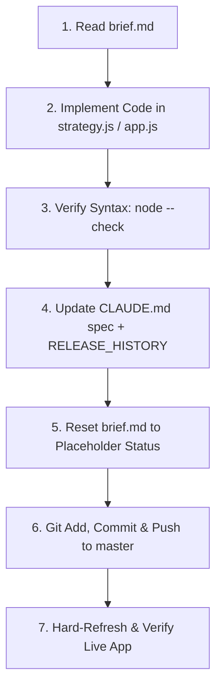

# Rocket Scanner — Live System Spec & Release Runbook

This document is the single source of truth for how Rocket Scanner works **today**: architecture, trading rules and the release workflow. Keep it current: when a release changes behaviour, edit the section it changes; do not append a changelog here.

## Mandatory Multi-Agent Alignment & Verification Protocol - 9 November 2026

- **Every implementation must be verified with multiple specialized subagents/agents.**
- Before writing, modifying, or deploying user-facing strategies or core logic, run a multi-agent critique loop:
  1. **Intent & Transcript Auditor:** Audits the conversation history from Step 0 to ensure 100% alignment with the user's explicit prompts, instructions, and constraints (no invented rules, no hallucinations).
  2. **Data & Experiment Verifier:** Audits the actual empirical math, scripts, and backtest results to ensure numbers and trade mechanics are mathematically true and grounded.
  3. **Implementation & Architecture Critic:** Reviews live code line by line to detect flaws, gate locks, whipsaws, or divergence between empirical research and production.
- All agents must cross-critique each other until a 100% unanimous consensus is achieved before finalizing code changes.
- Skipping this multi-agent alignment protocol is forbidden.

Current version: **v1688** (2026-11-12). Release history (v1386 onward, research notes) lives in local [docs/RELEASE_HISTORY.md](docs/RELEASE_HISTORY.md); v1-v1385 in [docs/CHANGELOG_ARCHIVE.md](docs/CHANGELOG_ARCHIVE.md). This file describes only how the system stands now.

StratGen research controls read only the current form: fixed shared_rs exits, selected history and auto-refine. Removed target/horizon controls are never accessed; older saved controls retain their supported history and auto-refine values, and running-job display uses the shared-exit summary. SDL is verified through its actual UI start handler into a live research worker.

StratGen core rows (CUM and Markov) are permanent, including before testing and after reset/restore. The service reconstructs them from the local baseline definitions; ranking and the displayed top 20 retain them without invented results. Generated rows alone expose Delete. Release Expert validates the helper-served inline script as well as the tracked JavaScript; the tab compiles the view before mounting controls.

Current owner policy (5 Nov): score-proportional cash allocation across eligible stocks, whole-share dynamic cost coverage and liquidity caps; the old minimum-allocation percentage, independent StratGen sizing, and legacy US floor are retired. Selected strategies (CUM and StratGen) evaluate identically across NSE and US markets; US live evaluation reads from the read-only TWS/IBKR adapter with order placement blocked. All Kite GTTs (trailing exits and profit-funded loss trims) are strictly single-leg (	ype: 'single'). Account replay inherits actual holdings/free cash. Strategy tests start flat with full real equity, then obey available cash and filled exit proceeds. Both use shared strategy.js planning/authorisation and account replay execution. CUM remains the permanent native baseline. Strategy drafts and current refinement/backtest progress appear immediately in the Studio. Discovery v1653 tests independent strategies guided by the current comparable winner. It first tests a separate copy of the seed once on a frozen comparison basis (recorded real equity, price files, completed dates, research/owner controls and engine/supplementary-input fingerprints). Later cycles propose one or a few local indicator/threshold/horizon changes, run each strategy once and retain a separate UUID row/run artifact. A flat experiment record stores the reference strategy/run, exact contract diff, proposal source and random seed; there is no genealogy, root, generation or inherited strategy status. Better measured closed net income/month, then total net P/L, selects the next parent; ties retain the earlier winner. Unmatched legacy results provide reference contracts only, never directly competing with a new comparison basis. A changed day, equity, execution/research settings or calculation/input basis starts a new comparison baseline. Manual Create & test strategy starts an independent experiment using the selected strategy as reference. There are no fixed family templates, mandatory 15 indicators, duplicate/contradiction screens, hardcoded RSI/candle/volume threshold rejection, or two-pass refinement/retest sessions. Unsupported executable schema/parameters are explicit errors rather than silently replaced values; EMA/SMA named periods are computed. Existing allocation/admission safeguards and shared exits remain. The native CUM definition stays unchanged; retained CUM signals keep native admission and score semantics in independent strategies that retain those inputs; added rules determine their entries. Research target/time controls remain captured and fixed across comparable strategies. Ranking uses closed net income per full calendar month without the former Rs300000 divisor/goal; open marks remain separate. Every completed strategy has an immutable archive; the active table retains the top 20 with protected baselines/selection. The Studio and Inspect expose experiment details and actual measured runtimes, and manual actions stay disabled during research. Previously recorded outcomes are preserved; no exact broker-fill or profitable-live claim follows merely from shared-code checks.

---

Owner execution controls (v1650, 6 Nov): Rankings toolbar has Target + % and Stocks per allocation (1-20). Values are helper-persisted in dev/execution-controls.json and included in actual account execution snapshots. Missing file preserves previous behavior (0% addition / 20-stock basket); unreadable state is preserved and blocked. Inputs save on change/Enter; Loss trim budget % also saves on change, with no ambiguous Save button. The allocation cap selects highest positive executable scores before whole-share water filling, including shared account/StratGen replay; browser/US manual sizing use the same count limit. Helper refuses stale allocation-count metadata rather than executing thin quantities from an old basket. Existing holdings are not sold by a count change.

Target + adds percentage points of weighted average cost to the dynamic GTT price, not a replacement return or repeated compounding addition. The shared wrapper retains raw dynamic state separately. An adjusted level above LTP becomes one single-leg profit-target GTT and is held for price to reach it, rather than chased on every uptick; a below-LTP level remains a stop. Existing confirmed levels never move down. The existing GTT ID is retained by PUT, with broker confirmation before UI adoption. Shared RS replay uses the captured addition; explicit target/time research exit overrides remain explicit. No live broker order was written during verification (NSE closed); nonzero addition was exercised with an isolated fake broker adapter. Research was cancelled before shared code edits and resumed with its prior controls; the interrupted refinement is not complete.

StratGen job lifecycle (v1651): a completed generate job once left discovery marked active after its thread died on WinError 5 replacing loop_state.json. JSON publication now uses unique temporary files, serialized writes and bounded sharing-violation retries without deleting the previous state. The daemon recovers from publication errors and exposes supervisor_alive; failed recovery is visible. Completion records phase, finish timestamp and duration, and supplies the completed strategy. The native UI has one job handler: it fills Studio details with the active draft/refinement, reflects actual test controls and explicit research exit overrides, marks unfinished diagnostics pending, disables manual research while the loop/job owns the worker, refreshes results on completion and freezes completed elapsed time. Main tab distinguishes discovery/recovery from service availability. Name is Autonomous Alpha Engine. Saved controls/results remain authoritative; no trading policy or account changes.

Strategy plug installation (v1654): Default (CUM) and Deployed are the two choices in the existing Active Strategy selector. The engine consumes rs-strategy-program-1 JSON: typed entry rules, parameters, execution/reference timeframes, declared common admission and shared RS exits. program.py is the shared executable-spec/compiler entry; backtests retain program_schema/program_spec/program_hash alongside test-window context. Deploy loads the immutable completed artifact, checks its original contract integrity, compiles its executable JSON and sends that same JSON to the receiver. Test target/time overrides stay explicitly in research_context and do not silently replace the approved live shared-exit policy. Deployment is executable-program installation, not a claim about historical P&L or broker-fill parity; no false live_parity flag is added.

Python and JavaScript use one engine-sources.json registry. The receiver performs an actual Python compile handshake before publishing either deployment file. Mirrored writes roll back on failure; selection failure restores the old plug/mode. Deploy reports a receipt only after installed ID/hash and selected STRATGEN read back correctly; the UI independently reads the receiver before announcing installation. An installed plug can be selected off-hours, with fresh session/prices and broker checks retained at execution time. Choosing Default leaves the saved plug installed and clears its client-side evaluation configuration; selection changes paint only after helper confirmation. Installing/testing the implementation does not switch the owner's live selection. The live worker uses the same evaluator, resolves CUM minute inputs and benchmark series, handles DataFrame versus dictionary payloads correctly, and aligns prior completed stock sessions when today's daily candle is unavailable. Reconstructed CUM inputs remain minute observations; the native default remains its original trigger path.

Leaderboard behavior (v1654): return and retain a maximum of 20 ranked rows, reserving the native baseline/current comparison baseline and any active plug. Original tests remain in immutable run artifacts and checkpoints. A leaderboard revision advances with the saved result file; both UI polls observe it and retry failed result fetches, coalescing overlapping loads. The list does not depend on broker capital being available. A missed transient COMPLETE job state cannot strand the display. Refresh errors are visible.

StratGen generation and presentation (v1653): model responses may use a JSON object, a list or a strategy/proposals wrapper; normalize these shapes and explicit minute units without changing quantities. Store returned proposals before capability checks and queue additional strategies. Provider HTTP429 applies durable key-level Retry-After/backoff; other failures apply model-level cooldown, rather than retrying all models every loop. During provider outages, generic numerical search varies an existing threshold using the spread of matching tested values (current magnitude when no spread exists); it changes no handcoded trading rules, discards no proposed strategy based on profitability and performs the full frozen-account backtest. Output identifies Numerical search; archived model responses/errors and provider retry timestamps remain local. The loop no longer depends on a successful external model request for each strategy. All strategies have flat identities and experiment metadata, with no family labels in prompts, Studio, tables or exports. Older leaderboard metadata is projected into the same flat form; original immutable artifacts remain. Native and comparison baselines have a blue row edge/background and Baseline label, no Delete in table or Inspect, and server-side delete/reset protection. Toolbar distinguishes shown from saved counts. Account controls and execution code are unchanged.

StratGen comparison table (v1649): readable 14px compact rows, plain strategy names without badges or inline test prose, ten comparison columns, calendar-normalized closed net/month and separate total net. Capital is a plain toolbar value; the old status strip is removed. Inspect contains test context/turnover details; secondary row actions use one menu. Responsive priority columns avoid horizontal clipping at desktop widths; header sorts persist across polls. Open Positions removes the Pace, SL and Risk display columns; broker exit, scoring and research/account logic are untouched. Background research is not restarted for these UI changes.

## 1. Current system

v1680 (owner 11 Nov): Unified Profit-Underwritten Opportunity Swap (PUOS) architecture. Standalone loss trims to idle cash are retired; no standalone GTT sell orders are placed to sell losers into cash. The 5-session net profit pool (configured via `Loss trim budget %` in the top bar) acts strictly as the underwriting risk buffer for Opportunity Swaps. An Opportunity Swap is only permitted if the sacrifice loss is fully covered by available booked net profit (`LOSS_BUDGET.available()`). An asymmetric expectancy hurdle is enforced: the incoming buyer's potential target gain must be >= the sacrifice's realized loss; if the sacrifice's loss would exceed the buyer's potential target gain, the sacrifice is resized to a smaller partial trim so the swap is net positive upon reaching target. When booked net profit is zero, loss-bearing swaps are completely blocked to preserve account principal. Manual Buy Basket and Kite Auto-Send buttons are retired.

Loss budget (current v1683 calculation): the saved Loss trim budget percentage underwrites Opportunity Swaps only. Its base is the previous four trading sessions' booked net plus today's booked winning net, floored at zero; apply the saved percentage, subtract today's booked losses in full, then subtract outstanding reservations and the Rs5 cushion. This is the existing calculation, not a change to the owner's setting. Missing session history or unvalued reservations hold new trimming without discarding an active trigger. Active GTT reservations are preserved through rollover, reconstructed from broker GTTs and repriced without releasing the old reservation first. The current pool uses RS operational weighted cost and estimated fees. It is not reconciled to Zerodha Console FIFO; the user's verified November P&L screenshot differs and has no day-wise/charge breakdown. Do not describe this pool as broker-confirmed P&L. The current research snapshot records the selected percentage and replay uses that recorded setting.

v1647 StratGen: deletion during research uses a cross-process file lock and a deletion revision. A running result cannot resurrect a strategy deleted after its start; its immutable run artifact remains. Other rows and the permanent CUM baseline remain protected. User discovery was resumed with its prior controls after deployment. During preparation, refinement c7b4126361f84f3c8f78c9304c706cdb failed because shared replay code changed mid-test; discovery continued. Do not describe that interrupted refinement as complete.

Research controls (6 Nov v1646): transient poll failures reconnect to the same existing job without reporting a failed generation or starting a duplicate. Health and job responses release the service lock before disk reads and socket serialization. Research controls (6 Nov v1645): StratGen target/time mode sells each modeled trade at the selected gross price target or elapsed MIN/H / T+N-session-close D / calendar-month M deadline, whichever is executable first. Outside market hours use the next observation; volume may produce partial or delayed fills. Separate history controls bound research to completed sessions; current real total equity starts flat, with shared sizing, reserves, liquidity and fees. RS trailing remains a selectable research mode. Target/time artifacts disclose their research override; Deploy installs the executable entry/shared-exit program with that test context retained separately. The former automatic top-five refinement setting is preserved in legacy controls but no longer schedules extra tests; discovery uses winner-led children. NumPy admission masks, selective expensive indicators and research event skipping preserve candidate ordering, filled-sale cash release and the minute-close equity curve. Discovery never invents fallback capital; missing equity waits visibly. The RS page forwards job progress into the native research view; failures remain visible.

Single sell GTT (6 Nov v1645): All sell creation calls pass the serial GTT lane, read the authoritative broker list and PUT an existing same-symbol CNC sell trigger. Duplicate reconciliation retains one ID without expanding partial loss quantities. Main and loss exits share the trigger; a loss-to-main handoff updates that ID and releases the loss reservation only after confirmation. Price, quantity and legacy type changes use PUT. Ambiguous creates block a second create. Loss quantities remain constrained by the existing five-session pool. The LLOYDSENGG duplicate exposed an undefined loss upper field after a successful broker create; that field is now explicitly null.

**StratGen deployment selects the strategy (v1634, owner 5 Nov):** deploy is one atomic action. The helper validates and writes the tested contract (`deployed_strategy.json` plus the `Scanner Uploads` copy), then sets `STRATGEN` as the live model in `dev/btst-model.json` and kicks the contract runtime; clearing the deployment writes the contract out and returns the live model to `CUM`. The page's Active Strategy dropdown follows the helper within one 5-second poll (and the Studio posts an immediate message), so "deployed" and "selected" cannot diverge after a deploy, a clear, a page reload or a helper restart. The dropdown and the deploy/clear actions share one model writer (`dev/model-select.cjs`).

**StratGen deploy gate (v1634):** deployment requires a real total-equity snapshot, an immutable test artifact whose engine fingerprint and shared allocation `codeHash` equal the running engine, the current rule-parity proof, the shared `rs-trail-min5-v2` exit, no benchmark operands, no CUM one-minute reconstruction, and an open broker session for exit protection. The parity proof (`dev/stratgen/parity.py`, `state/parity-proof.json`) is regenerated after every completed backtest and again at deploy time when the artifact already matches the running engine but the proof file is missing or stale; a strategy tested on older code still fails the engine-hash check first. The proof compares the backtest signal at a completed bar with the live evaluator's response at the same bar end, plus completed-bar, rule-application and determinism checks; it is a rule-parity check, not broker-fill or profitability evidence. Checkpoint/restore is local research state only: this service does not publish git changes.

**StratGen delete and fallback (v1635, owner 5 Nov):** the CUM baseline is the only undeletable strategy; every other saved strategy can be deleted, including the live one. Deleting the live strategy retires its contract and returns the selected model to `CUM` in the same action (helper delete route); any other caller that removes the contract leaves a live `STRATGEN` model with nothing behind it, so a 10-second watchdog returns the model to `CUM` as well. The leaderboard row and the deployment file cannot disagree after a delete, a clear or a restart.

**StratGen backtest universe parity (v1635):** the backtest now applies the owner's saved REG1 surveillance rule (any configured column neither `100` nor blank) from the dated reports in `dev/research/reg1-archive`, so a session where live RS would have blocked the stock produces no backtest entry that day. Coverage is explicit: the archive holds 52 sessions (2026-08-05 to 2026-10-19); dates outside it keep the previous behaviour and the evidence records the coverage. Circuit/band locks remain unreplayed because no dated historical band ceilings exist; the next-minute/volume fill model already blocks entries once a stock stops trading. Both facts are written into each test's evidence (`surveillance_replay`, `execution_gates_not_replayed`).

**StratGen replay performance (5 Nov service fix):** the research backtest spends most of its time in the shared account/exit replay, not in scoring. Two measured costs were removed. The replay's minute loader parsed each symbol's entire Historical_1min file with the generic quoted-CSV reader and `Date.parse` per row; it now reads plain rows, stops at the window start (the file is newest-first) and skips days past the end. The 10-second loss check rebuilt the whole day's book on every call; the book is now cached until a fill, add or day roll changes it, and the check returns before touching the ledger when no trim is possible. Measured on a real-candidate replay: 1 month 38.3 s → 3.5 s, 3 months 95 s → 16.9 s, identical trades (41 / 84). A completed generate cycle is now dominated by the ~3-minute symbol simulation and should return to the old multi-per-hour rate.

**StratGen live evaluator scheduling (v1635):** live evaluation loads only the recent 45 calendar days of minutes (the RVOL and normal-bar windows need ~20 sessions), cutting a symbol from ~1.7 s to ~0.4 s with identical output. Symbols are re-evaluated at their contract's next completed bar, not every tick; a signal is valid until the next bar closes plus 30 seconds, with 90 seconds as the floor for 1-minute work (`strategy.signalTtlMs`). The per-tick batch is sized from the due set (20 to 60 symbols), and `/api/stratgen/status` exposes `candidates`, `batch` and `lastTickMs` so coverage is measurable. A 1-minute contract over a very large candidate set still cannot be swept inside its signal life; that limit is visible in those counters rather than hidden.

**Dynamic MLoT trailing exit without upper ceiling (v1621, owner 4 Nov):** the exit upper target leg is removed; sell GTTs are single-leg trailing stop-loss orders (`type: 'single'`), leaving upside unconstrained. Arming occurs when price clears delivery charges plus DP (`down(ltp - minGap) >= breakeven`). The ratchet adapts dynamically to live MLoT quantiles computed across rolling sessions in real time: Stage 1 (Breakeven Lock) holds the stop firmly at breakeven while gain is below the live 25th percentile (p25), preventing microsecond tick-shakeouts within the noise floor; Stage 2 (Active Trailing) trails new highs by the empirical regime gap (p50 - p25, at least 0.26%); Stage 3 (Extension Tightening) kicks in past p75 to lock in peak profits before mean reversion. Neither leg ever drops.

**Same-day addition protection (v1620, owner 4 Nov; retained for loss-bearing Opportunity Swaps):** any filled same-day CNC buy into a carried opening holding blocks profit-funded loss trims for that stock until the next IST session, regardless of amount or signal source. Existing active loss-trim GTTs are cancelled and broker-confirmed through the existing cancellation path before new reservations. Pending/unfilled buys do not qualify; new positions with no carried opening quantity retain existing exits. Entry/scoring rules and ordinary profit-protecting exits are unchanged.

**Background reliability (v1619, owner 4 Nov):** browser-order reconciliation is single-flight, retries one transient read after 300ms and backs off repeated failures to 30s; it never retries an order submission. Complete broker snapshots are required. Definitive browser notSent responses expire an intent instead of creating false unknown state. Legacy unknown/no-ID records with the bridge-only pre-POST "Order authorisation expired" reason expire only after a complete broker snapshot has no matching order; matching broker orders take precedence, and all genuinely ambiguous outcomes remain held. /api/auto-buy/status exposes reconciliation and target-worker diagnostics. Evolving target refresh checkpoints complete preview-log byte offsets with file identity/head/tail validation, re-reads changed/truncated logs and incomplete/future lines safely, limits minute reads to each unresolved symbol's required history, and skips unchanged record/source windows. No records are dropped or falsely finalized; price observations still update. Cache/checkpoints publish atomically with the ledger, so failure cannot advance them separately. Worker failure logs identify timeout/exit code and stderr instead of only printing a command. Local .vscode/settings.json excludes data/research/archives/virtualenv from Pylance while preserving active production code.

**Whole-share allocation (v1618, owner 4 Nov):** shared strategy.quantityWithinBudget floors shares to fit the entire buy debit, with the existing CNC charges (and execution cash cushion). The saved Min Allocation is rounded down to an attainable whole-share notional for eligibility; it never forces a ceil-quantity above cash, per-stock or liquidity caps. The independent charge-based Rs5,900 economic floor and one-share adds remain. The main basket planner has no round-up override. Helper minOrderFor uses the same attainable minimum, and bridge final authorisation re-floors quantity against cash and the saved per-stock cap at the current order-limit price. Budget sizing may legitimately allocate more than Min Allocation when the existing per-stock/share limits allow it. Saved inputs, score rules, crossing checks, exits, accumulation and funding priority are unchanged.

Rocket Scanner is an intraday-entry, open-ended-hold system on NSE cash equities (CNC delivery, long only). It is **not** a BTST system any more: there is no buy-at-close and no next-session or T+2 deadline. The release history uses the old name. Internal file and function names (`dev/btst_engine.py`, `btst_rank.json`, `btst_picks.json`, `btstCrossingState`, `/api/btst/*`) keep the old prefix on purpose: renaming them buys nothing and risks breaking the helper.

**Scoring (engine).** The helper (`dev/server.js`) runs `dev/btst_engine.py --preview --model <selected>` in a new slot every minute 09:20-15:30 (a run that is still going skips the slot, so a warm ~55-70 s run is followed straight away by the next; plus 15:05 and 15:15 runs). At 08:30 weekdays it runs `--pretrain`, which builds the coming session's panel cache and any due 5-session Ensemble retrain (~10 min) before the open, so live runs only score. Live runs no longer compute the size-bucket baseline (`sizeRun` is published empty). The crossing baseline keeps each stock's last observed score, so a stock missing from a thin run (e.g. stream reconnect) cannot reappear as a fresh crossing (27 Oct) and publishes the full ranking to `Scanner Uploads/btst_rank.json`; the app polls it every 20 s. **Selectable models (v1539, owner 23 Oct; STACK removed 27 Oct; STRATGEN added v1623): Ensemble (ENS), PATH, Cumulative Change (CUM), and StratGen Alpha (STRATGEN).**
- **CUM - VWAP Trend & Breadth (v1636, owner 5 Nov).** Raw v1617 VWAP-gap scoring and zero crossing remain unchanged. The first native accelerating two-rise trigger is consumed even when the new filter rejects it. DX_market60 requires second rise >3x first, positive score <0.5, above exchange VWAP and opening-range high after 09:30; sample membership is the frozen March-selected 200 names in strategy.js CUM_REFINEMENT and dev/cum-baseline.json. At least 100 fresh sample quotes and >=50% above session open; previous completed stock close > EMA20 > EMA50; >=60% of sample previous closes above EMA20. Daily context warms asynchronously per IST date, uses all available earlier completed daily closes, and fails closed until ready. Missing/duplicate/stale paired quotes and warm-up never manufacture crossings. Rebuy/below-average held-add rules, surveillance, common score allocation and exits remain, with no minimum/maximum hold. dev/cum-baseline.json imports the retained April 1-November 4 modeled research ledger with actual equity snapshot; rankings expose dates, capital, realized/open net, friction, PF, payoff and drawdown. Different test periods are disclosed and no vs-CUM delta is shown without identical execution policy, dates and capital. The CUM Backtest action uses cum_candidate_signal_1m with the same frozen sample/trend/breadth entry filters; it is a candle reconstruction, not exact native tick fills. Old baseline definitions remain preserved in the research snapshot; no existing strategies are automatically re-tested.
- **PATH is the fixed PATH.** It uses PATH's 12 minute features, but is trained on our trade: the cost-aware ±1.25% barrier net, with intraday charges for same-session exits and delivery otherwise. It trains on the live-tradable universe only and retrains monthly.
- **STACK: removed 27 Oct (owner).** `dev/stack_live.py` still computes it alongside PATH, but nothing publishes, shows or trades it; its paper account is archived as `retiredModels["M:STACK"]`.
- **Where they come from:** both are computed on every live run by `dev/stack_live.py`, continuing the nightly end-of-session state (`dev/hypotheses/state_h1.pkl`, `state_h2.npz`) through today's completed stream minutes. Live inputs equal the batch (`dev/stack-live-check.py`). The models are `dev/research/models/{STACK,PATH_FIX}.pkl` (`train_live_models.py`, monthly).
- **Scale:** their raw predicted net % is ranked in the run and mapped through `ENS_CAL`, so floors share the Ensemble scale. Default floor 2.1, about the top 2–3 stocks, because both were validated as top pick only. Saved floors live in `dev/btst-{path,stack}-ranked-min-score.json`; the old 0–1 PATH floor file is ignored.
- **Freshness:** `pathPrediction` / `stackPrediction` must be within 180 s, with the feature within 90 s and the current session; otherwise the selected model is unavailable, with no substitution.
- **Failure handling:** a PATH/STACK failure never affects the Ensemble.
- **Guards:** the 5% density guard is Ensemble-only.
- **Evidence:** production account replay, Rs3.5L, 09:16 entries, live exit. STACK top 1: +Rs11.0k (6 Aug–10 Sep) and +Rs9.1k (11 Sep–21 Oct). Fixed PATH per trade: +0.38% / +0.27% against a −0.2% / −0.3% shuffled control. Neither improves the Ensemble's own picks, so neither is blended into it. Both run as comparison members (`members`/`memberRankings` PATH, STACK) under their own floors. Ensemble is five models (A, CLS, XS, Q25, ET) trained walk-forward on the last 220 sessions and retrained every 5 sessions, each ranking every stock; the mean percentile is mapped by `ENS_CAL` (1.2 = top 3.5% ~45 stocks, 1.6 = top 1.5% ~20, 2.0 = top 0.3%, 2.2 = every model ranks it #1). **The score is a rank, not a confidence or an expected return** - higher has not meant better (v1497). **Market data (v1530, owner 21 Oct): one-minute candles are the only stored market data.** History = `Scanner Uploads/Historical_1min/<SYM>.csv` (broker minutes, newest first, rolling window = current calendar quarter + the 4 complete quarters before it, pruned on merge; `dev/minute-backfill.cjs` tops up and deepens it outside market hours, symbols = minute store + NSE mainboard EQ list); today = `Scanner Uploads/Session_1min/<day>/<SYM>.csv` (completed stream minutes, kept 7 days). The broker minute wins over a stream minute. Every 5-minute and daily view is aggregated from them (`dev/minute-source.cjs` MinuteStore for the helper, `dev/minute_store.py` for the engine/review scripts); daily close = typical-price VWAP of 15:00-15:29 (NSE's last-30-minute rule; median 0.03% from Kite closes on 7,963 stock-days), else last trade. The Intraday 5-minute files, Kite daily `.1d` files, the 5-minute Archive and Historical_5min were deleted 21 Oct; no 5-minute or daily file is written. Engine daily panel: every minute-store symbol, core (market/sector/breadth inputs) = >= 60 sessions; per-symbol daily cache `dev/minute_daily_cache.pkl` (first build ~6.5 min, warmed by the helper after each backfill pass that changed history); days older than the minute window come from the accumulating `dev/btst_daily_store.pkl`. Liquidity cap: 75 slots per session, a slot with no traded minute = zero-turnover bar; cached per session in `dev/bar_turnover_cache.json`. Research scripts under dev/ that still name the old folders are not part of the running system. Inputs: 52 daily-candle features incl. sector strength and 5 market features; today's partial candle with volume projected to a full 375-minute session (v1494). Model A is a member, not a separate trading model; its raw level shifts with market-wide inputs and must never be read on its own (15 Oct guard fix). Universe: every streamed NSE EQ stock minus REG1 surveillance/non-EQ (owner's saved rules), stocks with under 2 sessions of history and circuit-locked names, all removed before scoring; held stocks are scored. Market-trend gates removed for all models, live/paper and US suggestions (v1567, owner 27 Oct). `strategy.entryGateApplies` always returns false; trend readings remain informational. Cumulative Change has no dependency on an ML gate reading. An Ensemble run with more than 5% of stocks above its floor is rejected as a bad snapshot. The engine rejects an implausible market move beyond +/-6%.

**Entry.** A stock is GO only in the engine run where its selected-model score crosses the saved floor (currently **1.6**; no minimum or maximum since v1549) and, for the Ensemble, stays below the 2.15 upper cap (v1497), any time of day with a fresh tick; no market-trend gate applies. **Entry pattern (v1578, owner 28 Oct): a crossing arms, it does not buy.** Every 10-second helper check (v1579; 20 s in v1578) compares each armed stock's live price with the previous check; the buy fires at the first check where the price rose at the previous check and rose again at this check by a strictly bigger percentage (the crossing check counts as the first rise when the price was up there; flat/down checks do not cancel). The wait lasts while the score stays at/above the floor; below it, the stock is disarmed until a new crossing. Crossings before 09:15 never arm. A trigger is buyable for 45 s and consumed when it fires. Shared pure rule `dev/entry-pattern.cjs`; helper state and triggers in `Scanner Uploads/entry_triggers.json` (dipEligibility `crossings` = active triggers, `rawCrossings` = floor crossings); page GO, helper auto-buy, final bridge validation and every paper account use it. All models. **Crossing definition (v1549, owner 23 Oct):** the engine publishes `crossings` = stocks >= floor now whose previous successful live run this session (same model, `Scanner Uploads/score_prev_<day>.json`) was not >= floor; the session's first run counts everything above as crossing. A stock already above the floor from an earlier run is never bought later; it needs a completed run below the floor and a fresh crossing. Score above the floor confers no priority: crossings are funded equally (when cash runs short: higher score, then earlier entry trigger, then higher normal 5-minute bar turnover; v1601) and the default table order (v1577, owner 28 Oct) is Trigger Status (GO, WAIT, BLOCKED, other) then score high to low, missing scores last, for every model; an explicit Model Score header click sorts the numeric score alone. This is a universal rule for every current and future model (the engine keeps a per-model previous-run baseline for every ranking it publishes). Page, helper auto-buy, native claim validation and paper accounts (own previous-run baseline per account) apply it. A purchase consumes its crossing; another buy needs an observed below-floor run and a fresh crossing, held or not (v1419). Only a buy made today consumes today's crossing: shares carried from an earlier session never mark a new day's crossing as already bought (v1599). Page status follows helper consumption, so a consumed crossing cannot show funded GO. Terminal unfilled IOC entries cannot be resubmitted on the same engine asOf; a fresh completed run is required. Automatic native handoff revalidates the current basket even when its plan matches a cached plan (v1514). Funding: equal share per crossing within Capital (Kite cash; v1549, was score-weighted); per-stock cap = max(capital x Max %, min(capital, All-in up to)); market-impact cap 0.10% of turnover traded so far and bid depth; **liquidity cap (v1523): never more than one normal 5-minute bar of the stock's own turnover** (engine `barTurnover[sym]` = median close x volume per 5-min bar over its last 20 prior sessions, >=5 sessions, else no cap; computed for every ranked stock, not only those near the engine floors, and pre-open by `--pretrain` - 27 Oct); **minimum position size (owner 28 Oct, v1586; v1603 owner 30 Oct): a new position must be at least the saved Min. Allocation (page box `fMinAlloc`, trade input `minAlloc`, which replaced "All-in up to"), never below DP / 0.26% = Rs 5,900 (the Rs 15.34 DP fee at most 0.26%); empty = Rs 5,900. Per-stock cap = max(capital x Max %, Min Allocation). The helper reads the same saved value (`minNewOrderRs`) for auto-buy and the final bridge check; an add needs one share; a crossing that cannot be funded at that size is skipped, not bought thin. When cash is short, the higher score is funded first, then the earlier entry trigger, then the more liquid stock (higher engine `barTurnover` median 5-minute bar; v1601, owner 30 Oct, replacing earliest-trigger-first and the alphabetical tie-break) (page planner; the helper buys in basket order). The retired v1526 rule follows for history:**: a new position must net at least half its gross +1.25% start after round-trip CNC charges incl. the Rs15.34 DP fee (currently Rs 3,812, recomputed from the charge table and target); an add to a held stock (re-crossing, red-day add, paper add) shares that sale's DP fee, so one whole share qualifies; up to 20 names per batch. **New buys from 09:15 (owner 28 Oct, v1575, `ENTRY_START_MIN`; was 09:16 from v1539, 09:45 before)**: every model may buy from the open; page WAIT, helper auto-buy/bridge, paper accounts, surveillance-cost shadow and filter benchmark follow it; exits and loss trims are unaffected. Ensemble/PATH engine runs start 09:20, so in practice only Cumulative Change can signal before then. Execution (v1508): Auto-Buy authorises CNC LIMIT IOC through Kite Bridge 1.6.0 and the logged-in Kite native client. Limit = fresh admission LTP +0.25%, tick-rounded down; offer within cap and <=10-second quote/book required. Intent expires after 30 seconds, final approval after 5 seconds. IOC cancels unfilled remainder immediately. Helper rechecks current model/saved floor/gates, cash and existing orders. Persisted single-use intents, native order tags and page ledger prevent automatic retries of ambiguous submissions; read-only reconciliation recovers IDs. Existing waiting buy GTTs block another order and retain legacy monitoring. New automated entries create no competing buy basket/GTT; Scanner_Buy symbol is cleared before submission. Auto-Buy OFF retains manual baskets; an unchanged plan is re-checked against Kite every minute, so a Scanner_Buy cleared in Kite refills (v1510). v1609: with Auto-Buy off and no live GO, that re-check syncs Kite to the saved basket snapshot (previously it stopped at an empty GO list and Kite kept an older set than the file); a hidden tab runs the pending Kite send on the 2 s worker tick; basket orders carry no attached +1.25% target GTT (the trailing exit sells; Kite created it on manual buys and the helper cancelled it) and buy alerts no longer print "@+1.25%". The bridge still never rewrites a non-empty Scanner_Buy that is open on screen, and Kite's basket list item count can lag until Kite reloads. Immediate (browser-ioc) entries wait up to 90 s to be claimed and the page claims them from a worker tick, so a background Rocket tab still buys (v1512). While the tab is hidden the same 2 s worker tick also runs the pending live paint and basket export, reads entry triggers when the push stream is down and keeps the 20 s cash/GTT beat on time (v1604: Chrome background-timer throttling had delayed trigger -> basket by 1-45 s, median ~40 s, against the 45 s trigger life). No "buyable now" crossing popup (owner, v1510). Confirmed partial/full fills reuse target GTT and runner tracking. Open logged-in Kite, reloaded bridge and Rocket page required; missing components hold entries. Red-day adds are disabled (`RED_ADD_ENABLED = false`, owner 22 Oct). **First crossing (v1537):** Trigger Status shows when the stock first scored the currently selected model's saved floor today ("1st ≥0.51: 13:18"), from the engine's per-run running score highs for ENS and PATH (`Scanner Uploads/score_highs_<day>.json`); "by HH:MM" = already above it when tracking began. Display only.
 **Volume-fade and size-bucket vetoes removed (v1538, owner 22 Oct).** Both were measured before the OCO bracket and profit-funded trims. Replayed on the saved 1-21 Oct Ensemble signals at Rs3.5L under the current exit with funded trims, no veto earned more than volume-only, size-only and both, in both halves (1-9 / 12-21 Oct) and all four fill assumptions (main: none +Rs5.6k / +Rs13.1k vs both +Rs2.2k / -Rs3.0k); cost: worst drawdown ~1.7% -> ~3.2%. Page, helper auto-buy, bridge validation, paper accounts and the surveillance-cost shadow no longer apply them. The engine still publishes `volFade`/`sizeRun` (unused for entry).

**Exit (v1621, owner 4 Nov): dynamic MLoT trailing, no upper target.** Breakeven = the sell price at which the whole holding nets Rs 0 after CNC delivery charges both ways and one Rs 15.34 DP fee spread over the shares (`bracket-exit.cjs breakevenPrice`). Before arming there is no sell order. Arm when `down(ltp - minGap) >= breakeven`. Then a native single-leg stop GTT (`type: 'single'`, `orders[0].price = lower`). The upper target leg is removed entirely to avoid capping runners. Trailing ratchets dynamically using real-time MLoT quantiles from rolling sessions (`MLOT_HISTORY.getLiveQuantiles()`: p25 noise floor, p50 median peak, p75 extension). Stage 1 (gain < p25): stop stays anchored at breakeven, giving noise room to breathe without risking capital. Stage 2 (p25 <= gain < p75): trailing stop follows new highs by the empirical regime spread (p50 - p25, at least 0.26%). Stage 3 (gain >= p75): trail tightens to lock in top quartile gains before downside reversion. The stop never moves down. Small holdings carry a high breakeven because of DP. No time exit.

**Historical standalone partial-loss behavior (retired by PUOS v1680; not an active sell path).** Only the **single worst holding below its cost** is trimmed at any time (v1608, owner 2 Nov: "just keep the worst one"; a holding that already carries a live trim keeps the slot while still eligible, otherwise the worst eligible one; helper `trimTarget`). The -1.25% qualification is removed and the learned cutoff is not used (v1603, helper `ANY_LOSS_CUTOFF_PCT`). v1603-v1607 trimmed worst-first down the list while budget lasted, which on 2 Nov sold slices of fresh buys within seconds (AUROPHARMA 1 sh 10 s after buying, GRANULES 3 sh after 62 s). The funding pool is the **last 5 sessions** (today + the 4 sessions before it, `LOSS_POOL_SESSIONS`): the configured percentage of their net booked profit after all wins, losses and completed trims, less outstanding reservations and the Rs5 cushion (owner 6 Nov; saved value 40%). Each session's booked net/wins are stored in `loss_budget_state.json` history (26-29 Oct backfilled from the helper's own opening ledgers + tradebook, BSE fills included). The loss-cutoff learner still records and replays with its one-day pool, but its result no longer controls trims. The same runtime cutoff drives live placement, loss-budget status, paper eligibility and worst-first paper reservations. Up to the configured percentage of the remaining five-session net profit, after all losses, less reservations and the existing Rs5 cushion, funds whole-share trims. No available booked profit means no loss sale. Page/live/paper use the shared booked-session fee ledger; a sale is booked the way Zerodha books it (same-day buys first, then carried shares at their opening cost; v1600, owner 29 Oct, replacing the v1598 pure-average booking). **A holding added to today (by hand or by the system) is not loss-trimmed today** (v1620: any positive filled CNC buy, including one share or a partial fill; no Min Allocation threshold): Zerodha would match the trim against the new shares and undo the average-down. Positions first bought today can still be trimmed; estimates remain subject to contract notes. Confirm cancellation of legacy/unaffordable loss GTTs before reserving replacements; uncertain creates retain reservations. Remaining shares stay held.

**Bracket recorder and live-policy replay (2 Nov helper fix).** The forward recorder retains ticks, bid depth and causal behavior snapshots through the next observed session after a position cycle closes. The last 40 mature observations, ordered by close time, form the review window. Missing entry, unreliable inventory, gaps and unfilled exits remain ineligible; older successes are not substituted. A changed mature window triggers a bounded replay worker. Its policy signature (`live-trail-v1581`) invalidates cached results from the retired target/zone replay without deleting recorded paths.

The replay starts with no sell legs, calculates the same delivery-fee breakeven via `bracket-exit.cjs breakevenPrice`, and calls the same `trailStep` used by live execution: max(0.26%, Rs0.10), tick rounding, legs never lowered, and current quantity/cost after adds. Existing one-second write delay, old-leg triggers during pending modifications, observed bid/partial LIMIT fills, coverage rejection and fee ledger remain. The obsolete fixed +1.25% target, approach-zone and adaptive-distance search have been removed from this path. Results are explicitly review-only and cannot write the parameter file or change live trails. Causal behavior recording remains available; its legacy coefficients do not control the fixed live ratchet. This fixes the replay policy mismatch, not a new MLoT research or portfolio replay system.

**Independent position reconciliation (v1519).** During weekdays 09:00-16:00, the helper targets a fresh broker holdings/positions/orders snapshot every 10 seconds, independent of page visibility or closure, with immediate batched order-event refreshes. Snapshots are single-flight, routine callers reuse a fresh snapshot, and only urgent events queue a follow-up while a read is running. Order events immediately hold affected bracket mutations; a newer event during a read requires another authoritative snapshot. GTT reconciliation has a 10-second interval and event-driven bypass. Monitor failures back off up to a minute and remain visible in status; unknown basis continues to block mutations. Native OCO handles its own sibling. The legacy separate-stop re-arm path is disabled for brackets. All GTT writes retain the existing paced lane, five-second stale-write expiry and 429 cooldown; cancellations and sell protection outrank queued routine buy requests, without interrupting an in-flight broker request. Full-market scoring remains every two minutes.

**Loss-cutoff learning (v1520).** `dev/loss-cutoff-learning.cjs` records funded portfolio decision cohorts whenever a real inventory/fill revision supplies a new opportunity, including candidates between the minimum searched cutoff (0.5%) and the active cutoff that remain unsold. Price-only repeated polls of the same decision are deduplicated. Capture requires reconciled basis, fresh two-sided quotes, known positive unreserved profit, and no open sell/uncertain or existing loss commitment. One shared local tape per session records all watched stocks through the next observed session, including after an actual sale. Cohorts may overlap; they are decision observations, not 40 independent closed trades.

The last 40 mature decisions are replayed as fixed-initial-inventory portfolio experiments. Every cutoff sees the same initial positions, opening ledger, booked net pool and subsequent actual ticks/depth. Subsequent unrelated entries or external profits are excluded rather than invented. Profit exits use the recorded bracket/adaptive policy; loss orders respect worst-first allocation, partial depth, LIMIT waiting, a one-second placement delay, ten-second decision cadence, 90% funding, pending reservations and the Rs5 estimate cushion. The booked funding pool resets by session. Unsold positions are marked at observed horizon prices after estimated liquidation charges; marks are valuations, never claimed fills. Missing coverage invalidates a candidate instead of replacing the decision with older evidence. Search 0.5-4%, require improvement in both chronological halves and revalidate the 25% step; +1.25% profit start is fixed. Until validation, retain the current/initial 1.25% cutoff. Corrupt cutoff artifacts pause new trims and remain preserved. Both learners share one background-work slot. Status exposes separate loss-decision readiness and actual cutoff. These cohort replays validate a conditional exit rule; they do not establish full-account reinvestment performance.

**Helper window (owner, 16 Oct).** Never close the visible helper console during a restart. `Start Rocket Scanner.bat` calls the persistent `dev/helper-loop.bat`; restart only its Node worker child, leaving the cmd window alive. A launcher opened while the helper is already listening reuses it rather than killing it. The current visible cmd parent is persistent; discover current worker/window PIDs before acting.

**Session timing.** Until 6 Dec 2026 NSE runs a closing auction 15:15-15:35 for cash stocks that have F&O contracts (their continuous trading ends 15:15 since 3 Aug 2026); all other stocks trade continuously to 15:30. From **7 Dec 2026** (SEBI circular 15 Oct 2026) the auction is 15:30-15:40 (market+limit to 15:36, limit only after, random close 15:38-15:40), so F&O stocks also trade continuously to 15:30; post-close session 15:50-16:00 at the auction close; stock/index derivatives to 15:45; expiry settlement on the last-30-minute VWAP. From 8 Feb 2027 unfilled limit orders carry into the auction. The page derives each stock's continuous close via `casContinuousEndMin()` (`CAS_V2_DAY`), switching automatically at 00:00 IST on 7 Dec; the helper's 15:30 session end and candle builder already fit both regimes. Our picks are mostly non-F&O small caps; none of the 86 stocks signalled 29 Sep-14 Oct is an auction stock.

**Surveillance filter cost (v1544, owner 23 Oct).** The Methodology table shows, per configured REG1 rule, what the **selected model** would have made on the trades that this one rule alone blocked: gains missed, losses avoided and "If filter off" (net after charges, added up since the first observation), with a Saving you / Costing you verdict. Tracker: `dev/surveillance-cost.cjs`, ledger `Scanner Uploads/surveillance_cost.json`. Each would-be trade is one Rs5,000 buy held to that session's last minute, from 09:15. Live candidates come from the engine: Ensemble via `surveillance_cost.score_shadow`, and PATH/STACK via `stack_live` blocked-stock predictions, with their inputs placed into the tradable ranks and the score ranked against today's scored stocks. PATH/STACK history 6 Aug-21 Oct was backfilled by `dev/research/surveillance_backfill.py` (monthly walk-forward models, the previous session's dated REG1 in `dev/research/reg1-archive`). Ensemble has no history (its blocked-stock scores were never saved), so it fills forward. Display and measurement only; it never changes the filter.

**Performance (v1593, owner 28 Oct).** Real-trade analytics remain. All live model-comparison paper portfolios, simulated funding/fills, background ticks, state saves, context uploads, comparison/backfill endpoints and their Performance UI were removed. Existing paper history and retired modules are archived locally under dev/retired/paper-trading-*/ and are never loaded by the helper. Ensemble/PATH/CUM scoring, shared live loss budgets, exits, real execution records and saved settings remain active. Broker inventory valuation is in dev/inventory-value.cjs.

**Exit opportunity display (v1614, owner 2 Nov).** Both Latest Session and MLoT history consume the same helper-owned per-stock summary from `/api/mlot/history`, calculated from deduplicated actual NSE and BSE sale fills and completed same-day one-minute candles strictly after each fill. Ambiguous sale candles, unfinished candles and later dates are excluded. Re-buys do not truncate the window. BSE sales use the corresponding NSE minute path when BSE prices are unavailable, per owner instruction; the row and history session explicitly say NSE proxy. Missing observations remain unknown rather than zero. Latest Session matches the helper stock's quantity and average sale proceeds within the displayed half-paisa rounding tolerance before showing observations; stale/partial tradebook coverage is withheld. The browser no longer adds local five-minute bars, entry peaks or live quotes to these amounts. Both tables refresh together when a recorder snapshot arrives. Total rupees and covered sale proceeds come from the canonical stock rows; prominent percentages and sale-to-peak delays are per-stock medians with zeros included and unknowns excluded. Rupees show two decimals in both tables. Peak timestamps are one-minute candle starts, not precise tick peaks. History counts all recorded NSE/BSE sales/stocks and discloses incomplete coverage; its footer sums daily stock counts, uses proceeds-weighted %, and takes the median of daily median delays. The within-15-minute columns have been removed. Persistent helper records in Scanner Uploads/mlot-history retain actual fills, minute paths, coverage and session summaries. Available sessions are recomputed from stored fills; unsupported dates are disclosed. Collection runs in the hidden recorder worker with no additional broker requests; learning is review-only and never changes orders. Latest Session uses shorter headers (Score, Cost, High, MLoT, Avoided, Peak time, Fees and Gross) to keep the rightmost P&L % visible at desktop width. The go-to-top control sits in the sticky header, reserving its space while hidden so it never overlays table cells or shifts the navigation.

**Signal replay (owner 5 Nov).** Research uses finite total account equity, recorded and timestamped from current holdings market value plus available cash, initially redeployed as cash. Entry reserves and filled-sale cash releases are chronological. Stored research from the earlier convention is archived under its original policy; it is not relabeled as a funded result. Live entry, surveillance and broker-order settings are unchanged.

**Daily routine.** Day-end review is done in chat with the owner after the close (`python dev/model_review.py`). Evidence for the current rules is in the v1496/v1497 entries of docs/RELEASE_HISTORY.md. Older evidence there (16 Sep walk-forward, 21 Sep horizon replay) was measured on the retired buy-at-close system: it is history, not validation of the current one.

**Live position cost (v1516).** Operational inventory uses one moving weighted average and the broker-confirmed total quantity. BUY blends remaining principal plus actual fill value; a SELL releases cost the way Zerodha books it: same-day buys made before it first (earliest first), then carried shares at their opening average, so a same-day add that is sold again leaves the carried shares at their own cost (v1600; before v1600 a partial SELL released average principal); a full close resets the basis and peak/runner state before re-entry. The helper reconciles individual /oms/trades executions against each filled order (including cancelled partial fills) and current holdings plus CNC positions. Opening basis is persisted separately; unknown or inconsistent evidence holds new exit mutations. Page, runner and target creation use the same reconciled average. New buys rebase the original target percentage and resize the existing GTT together, with broker confirmation; legacy sub-paisa display-rounding differences do not alone rewrite targets. Existing locked runner stops never loosen. Historical broker P&L, charge/netting matching and buy-window opportunity attribution remain separate accounting views; operational targets never use their FIFO lots. Paper inventory follows the same weighted basis prospectively, without rewriting prior results.

**Runner action learner (v1516, local shadow only).** New 32-tree action learner trained on 55,599 causal states before 31 Aug; calibrated on 8,231 states ending before 18 Sep. PATIENT/NORMAL/TIGHT predictions use completed price/volume bars and current position features. Later cash-account comparisons include fees, principal reuse, reserved partial-loss budgets and delayed-cash/adverse-fill stress. Validation failed: Ensemble worsened in every declared case; Peak improved only under normal fills and has just two signal days. Historical OHLC proxies and surviving-universe sampling are limitations. No live promotion: the helper can record forward shadow decisions/features and serves /api/runner-learning/status; no learned action controls orders. Details in dev/runner_learning_results/account_validation.json. Five-minute owner notifications remain stopped.

**PATH paper controls (v1531).** Corrected schema3 intraday/T+1/T+2 candidates run in a separate asynchronous process after successful live Ensemble publication. Raw forecasts remain in local research storage without Ensemble strategy vetoes. P: portfolios are explicitly labelled Ensemble-policy controls: identical saved floor, entry gates, targets, exits, capital and cost treatment isolate the ranking change. They are not PATH-native strategies. Profit-funded loss trimming applies to PATH too, using the existing realised-profit budget and eligibility protections. Stale, diagnostic, mismatched or incomplete snapshots cannot enter paper accounts. Existing member accounts and live Ensemble votes remain unchanged. Native PATH entry/target/holding research and held-out net account comparisons remain unfinished; offline event metrics are not trading returns. Fresh-session population/rendering remains to be observed.

**Filter persistence (v1612).** Capital and the other saved filters use guarded localStorage mirrors. If that cache is full, edits are immediately queued into a small IndexedDB recovery record, separate from the debounced full brain; startup and mode-specific restores choose the newer timestamped copy. Filter updates and brain persistence continue after a quota failure. Recovery-write failures are visible, and unreadable saved settings still lock saving rather than overwriting them. Explicit filter/brain reset also clears its recovery copy. Expired Cumulative Change crossing-cache keys from earlier sessions are removed when crossing state loads; current-session and unreadable records, surveillance rules and other saved settings are preserved.

## 2. Objective

Trading is the owner's only income. The monthly target is **dynamic**: it is whatever the Finance tab computes at the time (household need + EMIs, grossed up for tax, per trading day; helper `/api/finance`, data local only). Never hardcode or quote a stored figure - read the Finance tab when a number is needed. The target is a floor to clear, not a ceiling: grow profit through capital compounding and fast rotation. Judge results on monthly account profit after all charges incl. DP, together with open losses and capital tied up, never on win rate alone. A target never loosens trading rules (floor, band, exits).

## 3. Mandatory Release & Implementation Workflow

Every AI agent and developer **must follow this exact 7-step sequence** without skipping steps:

1. **Check `brief.md`**: Read `brief.md` for active instructions. If `brief.md` is in placeholder status, do not invent unrequested tasks; ask the user or await instructions.
2. **Implement Core Logic**: Make surgical, clean edits to [`strategy.js`](strategy.js) and [`app.js`](app.js). Do NOT add multi-layered speculative statistical models (e.g. median path templates, widening tick intervals) that freeze the scanner or block execution.
3. **Syntax & Verification**:
   - Run `node --check app.js`
   - Run `node --check strategy.js`
   - Run `node --check dev/server.js` (if modified)
4. **Update the docs**: set `Current version` in CLAUDE.md (the release gate checks it) and edit whichever spec section the release changes; append the release entry (what, why, evidence, checks) to the top of `docs/RELEASE_HISTORY.md`.
5. **Reset `brief.md`**: **Immediately reset `brief.md` back to placeholder status** (`# Active Task: None / Awaiting Next Instruction`) so future agents do not re-execute stale tasks.
6. **Deploy**:
   - `git add <code files>`. **NEVER stage, commit or push `CLAUDE.md` or `brief.md`**: they are local-only and `.claude/gate.sh` enforces it.
   - `git commit -m "vXXXX: description"`
   - `git push origin master`
7. **Verify Live**: Remind user to hard-refresh (`Ctrl + F5` or `Cmd + Shift + R`) on `https://axionaut.github.io/rocket-scanner/`.

---

## 4. Critical System Invariants (DO NOT VIOLATE)

1. **No Over-Engineering**: Do not re-introduce multi-sample websocket trend checks (e.g. `diff > prior.diff` across rungs) that block the entire universe from qualifying.
2. **Re-crossings can add to held positions (owner confirmed 5 Oct 2026).** The former no-averaging-down wording is obsolete. A purchase consumes its crossing; a completed engine run must explicitly observe the score below the floor before another crossing can buy again, held or not. Waiting/fired dip orders and unresolved exit cleanup retain their existing guards. Do not reintroduce a held-stock veto. See `executeAutoBuyOrders` and `resetAutoBuyCrossings` in `dev/server.js`.
3. **Exits: profit-funded partial loss trims on any holding below cost, worst first, funded from the last 5 sessions, no time limit (owner 16 Oct v1514; v1603 30 Oct).** Keep the OCO bracket exit above. A holding becomes trim-eligible only below the current learned loss cutoff (initially 1.25%, `LOSS_TRIGGER_PCT` in dev/loss-budget.cjs; replaced only by a validated loss-cutoff learner result), and a trim is funded only from today's booked net profit as described in section 1. The former -6% deep line (v1509/v1514) is retired. Never fall back to an unconditional full loss sale. The remainder stays held; this protects the estimated booked-profit pool, not the mark-to-market value of held shares. Do not add a holding-age deadline or silently change saved settings.

4. **CLAUDE.md is a spec, not a log.** Release notes go to `docs/RELEASE_HISTORY.md` (v1386 onward) or `docs/CHANGELOG_ARCHIVE.md` (v1-v1385); both are local only because they contain trades and P&L and the repo is public.
5. **Only a live, current-session, successful ranking can produce GO, funding or a basket order.** A replay, dry-run, other-session or failed engine file never can. The qualifying event is a stock's live score crossing the floor, not the file's stage (v1418); the 17 Sep loss (0 of 5 provisional names survived to the final) is why a stage or a list is never a licence to buy wholesale.
6. **Never state an agreement/accuracy rate that has not been measured.** The 17 Sep loss came from an agent's "provisional and final usually agree closely", invented on the spot. If the number isn't in a test or a backtest, say it is unmeasured.
7. **Never serve a file with a bare `.pipe(res)`** (v1399): an aborted request leaks the descriptor, and on Windows a leaked handle blocks `os.replace` **forever** — that is how the preview ranking froze for 97 minutes on 18 Sep while completed runs stranded as `.tmp`. Destroy the stream on client `close`/`error`. Every atomic write in the engine goes through `publish()`, never a raw `os.replace`.
8. **The basket file is a snapshot, not a live mirror** (v1402; v1426: the snapshot is kept only while current capital can still pay for it - a basket that costs more than the available capital is spent and is cleared). An automatic write may never replace a non-empty `Zerodha_Basket_Buy.json` with an empty one: GO is transient (needs an open market and a <30 s tick), so mirroring it erased the owner's basket at 15:30:03 and again on a stale tick at 15:18, minutes before he had to buy. Only a real new order set or an explicit manual export may clear it.
9. **A no-signal day is correct behaviour, and hit rate is not the objective** (v1404). Never treat a day with nothing above the floor as a broken run, and never lower the floor to "get a trade in". Any floor/band change must be argued on account-level profit over the whole session set with the real capital (including idle days and the time cash is tied up), not on hit rate, mean per trade or a win streak. On the live Ensemble (v1497) lower floors earned as much per trade but tied cash up longer (5.3 h vs 2.1 h median hold), so 1.6 still won at account level; the 2.15+ maxed-out scores lost money and are skipped.

10. **Surveillance (REG1) does not cover upper-circuit locks, and never will** (v1407; the engine gained its own circuit filter in v1418, but REG1 still does not and will not cover this). 21 Sep FEDDERSHOL and PROTEAN were frozen at +20% with **zero shares on offer** and carried **no REG1 flag at all** - verified against the loaded file, not assumed. NSE publishes ASM/GSM/ESM for *sustained* abnormal behaviour; a band lock that happens today is in no surveillance column today. Never answer "why wasn't this filtered" by pointing at the surveillance table without checking the actual REG1 row first. A locked stock is **BLOCKED**, not score-penalised: it cannot be bought at any price, so it is not a weak buy.
11. **The backtest never modelled an empty offer side** (v1407). The +1.18%/trade replay filled every pick at the close, so it silently assumed fillability. The circuit guard removes trades that number never accounted for - do not treat the measured edge as evidence that blocking them is unnecessary, and do not weaken the guard to "match the backtest".

---

Public repository cleanup (17 Oct 2026, 21cc677): HEAD contains only .gitignore, index.html, app.js, strategy.js, finance.js and styles.css. dev/, browser-extension/ and brief.md remain local; do not force-add them. The previously staged extension blobs were preserved exactly and now appear as staged additions against the cleaned HEAD; never include them in a release. A byte-for-byte original index backup is under dev/repo-cleanup-backup/1792221393/. No history rewrite was performed.

Accounting precision (v1524): Orders.csv preserves full broker weighted-average execution prices; the shared bookedSession and loss-budget ledger retain raw execution/basis precision and round monetary totals to paise, not whole rupees. Outstanding trim reservations revalue against that same ledger on each reconciled refresh. UI charges are explicitly estimated. Reconciled moving-average cycle P&L is the operational ledger; Zerodha may retain an earlier demat cost after sell/rebuy netting. Do not describe the broker's own cost as erroneous or confuse operational cycle profit with Console tax P&L. Contract notes and DP ledger remain the final fee source.
Volume curve completion (19 Oct, Peak-only; moot since v1529 removed Peak): Peak training caches now use prior-only 40-session curves, at least five complete prior sessions, and a new causal cache directory. Model and curve are one atomic bundle. After the next successful scheduled retrain, only Peak receives separately rebuilt curve-based features from the existing snapshot; Ensemble retains its original flat inputs and market gate. Before then the existing model/projection remain active. Read status peakVolumeProjection and peakProjectionSeconds. Training failure leaves the prior model intact; no forced daytime retrain or saved setting rewrite.

**Owner execution constraint (19 Oct 2026): No static IP. Do not propose static-IP infrastructure again as the solution. The existing browser-native BUY route has live proof: 19 Oct COMSYN, MVGJL, OAL and DBOL are completed IOC buys whose broker order IDs and RS tags exactly match persisted bridge intents and BROWSER_BUY_SUBMITTED audit events. Distinguish this proven BUY route from the still-unimplemented immediate browser SELL route. API_ORDERS_ALLOWED remains false; do not enable direct helper order placement. Before discussing execution availability, inspect actual intents, broker order tags and fills rather than inferring from API restrictions.

Browser execution approval check (19 Oct 2026): Published policy verification found no approval for the extension's automated order-client discovery/submission. Zerodha terms section15.2 prohibits reverse engineering/source discovery and robotic platform access; section16.3 addresses unauthorized scripts/extensions and market-data extraction. Official forum response explicitly says web-interface automation is unsupported and Chrome extensions do not create an exemption: https://kite.trade/forum/discussion/15896/using-selenium-to-update-watchlists-and-baskets . Our kite-import.js scans webpack module source and invokes the internal order client, so the engineering decision is not to extend that mechanism to automated SELL without written broker authorization for that exact method. This is a decision based on published policy, not an account-specific legal determination or a claim that broker support was contacted. Existing BUY fill evidence proves execution only, not approval; same concern applies. No settings, broker orders, GTTs or Auto-Buy toggles were changed by this check. Approved user-confirmed alternative: official Kite Publisher, with explicit confirmation of every order, as clarified at https://kite.trade/forum/discussion/15955/clarification-on-kite-api-offsite-order-execution-post-sebi-algo-circular . No static-IP proposal; owner ruled it out.

Paper comparison funding (22 Oct): six independent ENS/member accounts start from fresh broker net cash plus the reconciled marked CNC inventory, limited by a positive explicit Capital. Each starts in simulated cash and thereafter spends its own balance. The real broker cash is recorded but does not cap paper purchases. Live orders and profit-funded exits are unaffected. Missing/stale valuation holds initialization; models use the ENS floor regardless of the selected live model.

23 Oct v1545: strict JSON scoring publication removes non-finite PATH/STACK comparison rows; undefined numeric diagnostics become null. Browser score polling surfaces refresh/parse failures in Model Scores, retaining the last valid snapshot and clearing the warning on recovery. Live32-minute publication verified parseable; Chrome reproduced old09:05 -> malformed snapshot warning -> current09:32 with new table scores. No strategy/settings changes.

23 Oct owner standing authorization: implement requested Rocket Scanner fixes, run checks, bump versions, commit only relevant files, and push routine releases to master without asking again. This explicitly includes publication; previous v1545 approval block is resolved.
v1546: strategy.entryScoreCapped is the shared source for the 2.15+ cap. It applies only to ENS; PATH/STACK and individual comparison members are uncapped. UI, live candidate selection, final native claim validation and paper accounts call that same function. Volume-fade/size-bucket vetoes remain removed.

v1547: Methodology now begins with the filter decision table and sticky bookmarks. Default blocked-stock price benchmark uses a Rs5000 target rounded up to whole shares, first recorded traded minute open from09:16 to latest completed-minute close, estimated intraday charges; ignores model/gate and is NOT actual account P&L/GTT/cash replay. Only-this-rule net is separate from all-matching overlaps; no additive totals. Stock drilldown includes entry/mark times/prices/qty/charges/net and other rules. Model-qualified evidence remains a separate view. Current/older methodology prose retained below in sections/collapsed details. New local dev/filter-opportunity.cjs + install-filter-opportunity.ps1 registered RocketScanner-FilterOpportunity every3min09:18-15:36 and at login, skip outsidehours. Read-only generator does not change saved filters/orders; serves Scanner Uploads/filter_opportunity.json. Stale attribution is hidden after saved rule changes until matching refresh arrives.

First-crossing badge (v1548): score-run timestamp plus captured price and signed rupee/percent change to the current row quote. Legacy prior-minute references are marked~; missing history stays unavailable. Display only; crossing/order qualification unchanged.

Table sorting (v1568): every ranking data header is clickable, including Buyer/Seller (buyer share), Target and Alloc. Display rows, including US suggestions, share the selected comparator before pagination. Score clicks sort the actual numeric score both ways, independent of the default floor-nearest display for trained models. Explicit sort choice/direction is saved. Plain tables across Performance, Finance, broker panels and methodology use delegated header sorting with currency/grouping/unit/date/time parsing, missing values last, and totals preserved. Generic sort direction survives live table replacement using only explicitly sorted tables; dedicated sortable-table renderers retain their own handlers.

Cumulative Floor number-input step is 0.1 (owner v1568); no min/max.

First-crossing price move (v1569): CUM owns per-day running-score-high records in its v3 state, with score, captured live price and quote timestamp on every new high at a 20-second check. The app reads only that current reset epoch, never legacy CUM entries in score_highs_<day>.json. Re-crossing the same floor does not change its first reference; a new morning starts both scores and crossing history afresh at zero. The since price change is (latest verified observed price - first-threshold price) / first-threshold price * 100, with the rupee difference beside it. The current price comes from same-symbol, same-session live universe or timestamped score-input quotes after the reference quote, never an unverified table row. No known current quote means unavailable, not a fabricated return. CUM browser crossing/rebuy display state is namespaced by reset epoch; other models keep their existing state. Engine score highs stop writing CUM; ENS/PATH keep timestamped captured quotes.

Trigger Status total (v1571, exits v1572): each first-crossing badge counts a simulated buy at the captured crossing price that exits at +1.25% (TGT) or -1.25% (SL) in the first later Session_1min minute whose high/low reaches it (a minute touching both = SL); otherwise it is open at the verified current quote. Helper POST /api/crossing-exits computes exits asynchronously with a per-file size cache; the page asks every 15 s (v1589) for still-open rows. Header: sum in Rs and % (one share each), count, T/S/O split; tooltip adds equal-weight average. Gross, display only.

Cumulative Change first crossing (v1574): the helper records `upCross` = each stock's first 20-second check today where the score went from below the saved floor to at/above it, with score, price and quote time (dev/cumulative-change.cjs, published in btst_rank cumulative). A stock that has never been below the floor has no crossing; a floor change or new day starts a fresh record. The Trigger Status badge, its ±1.25% exits and the header total use upCross for Cumulative Change, not the running-high record.

Performance freshness and type (v1576, owner 28 Oct): the helper appends today's /oms/trades fills to TRADEBOOK.csv on each Kite order-update event that carries a fill (1.5 s, retried at 5 s and 15 s when Kite's trade list lags; an append bumps PORTFOLIO_REV so the page re-reads the tradebook on its ~1 s beat; v1589), with a 10-minute weekday fallback sweep (writes only on new fills); the page's input watcher reloads the changed tradebook and rebuilds Performance. Performance panels use the site type scale: 14px body/table values (DM Mono in tables), 12px uppercase table headers, 13px captions, 12px minimum.

Check cadence (v1579, owner 28 Oct): the Cumulative Change / entry-pattern check runs every 10 s (measured 1.1 s per check at 20 s, ~11% of the helper loop at 10 s); the page reads entry_triggers.json every 2 s (v1584). Faster than 10 s needs the per-check file writes trimmed first.

Cumulative Change paper account (v1580, owner 28 Oct): the model comparison adds `CUM`, traded from the helper's live 10-second record under the saved Cumulative threshold whatever model is selected (no threshold = no account/buys), same rules and entry pattern as the others. Retired STACK/PEAK rows are hidden from the pre-live history and method text.

Rankings table (v1581, owner 28 Oct): columns Status · Model Score · Symbol · Price · Day · Since crossing · Exit · Alloc. Status = one pill (GO / ARMED / WAIT / BLOCKED; ARMED = crossed and waiting for its two rising checks) plus one short line, full reason in the tooltip; default order GO, ARMED, WAIT, BLOCKED, then score high to low. Since crossing = crossing time/price and the ±1.25% TGT/SL/open result, with the column total in its header. Exit = for held stocks the live trailing exit from /api/profit-lock/status (arms ≥ price and breakeven, or SL · TGT legs). From High, Buyer/Seller, RelVol, Turnover and the fixed Target were removed from the table; no price-source label.

Entry claim retry (v1582, 28 Oct, LLOYDSENGG): a queued browser entry whose pre-submit check fails for a transient reason (no fresh best offer within the +0.25% cap, stale quote/book, broker orders/cash/session read) stays queued and is re-checked at most every 3 s until it expires; the note records best offer, cap and book age. Signal failures (no entry trigger, floor, model change) still expire it.

Minimum after cash shrink (v1583, 28 Oct, ENTERO): the final bridge start check, which reduces quantity to fit current cash, now rejects an entry whose reduced size falls below the charge-based minimum (new stock Rs 3,812; add: one share) instead of submitting it.

Charges (v1586, owner 28 Oct): `dev/charges.cjs` reads `Zerodha Equity Trading Charges.csv` (Equity Delivery / Equity Intraday columns; fallback to the same published rates). Breakeven always uses the maximum (delivery) charge incl. DP, even for a holding first bought today (owner 29 Oct; before that intraday rates applied on the buy day), so an armed lower leg still covers costs if the position is carried overnight. The signal replay arms on the breakeven of a minimum-size (Rs 5,900) position. Historical loss trim (v1586, superseded by single-leg GTTs and PUOS): the profit-funded trim was one two-leg GTT for the trim quantity, lower = price - gap (budget reserved at its limit), upper = price + gap, both ratcheted on new highs every tick (max one write per 2 s), never lowered; the reservation is repriced on each ratchet. Paper trims follow the same rule. Older single-leg trim GTTs stay until replaced.

Page sync (v1588, owner 28 Oct): helper GET /api/revs returns change numbers (score files stat, profit-lock/loss-budget signature, auto-buy/bridge signature, model comparison lastObservedAt). The page polls it every 2 s and downloads only what changed: positions/exit legs, auto-buy status and model comparison (Performance tab open) within ~2 s; the large score file at most every 10 s. Score-driven table redraws are at least 8 s apart. If /api/revs has not answered for 10 s the 20 s loop fetches scores/positions/auto-buy as before. Cash, GTTs, the paper-context POST, Kite basket syncs and alerts stay on the 20 s loop. Single-leg trims placed before v1586 are cancelled (confirmed) and recreated as two-leg ratchets.

v1590 (owner 28 Oct, helper overload): the 2 s change-number sync (v1588) is switched off on the page (the 20 s loop fetches scores, positions and auto-buy again; /api/revs remains on the helper, unused); crossing exits back to 60 s. Helper: charges CSV checked at most once a minute and breakeven memoised (it ran on every tick for every held position); parsed score files cached by size+mtime; paper pattern price memory not persisted and no longer forces saves; entry_triggers.json without price memory; GET /api/perf exposes per-timer/HTTP timings.

v1591 (owner 28 Oct): REVERT to the v1587 state. Page app.js = the v1586 code (no page change existed in v1587) with version 1591; helper files reverted to v1587 (no /api/revs or /api/perf, single-attempt tradebook append on fills, no trim-conversion/ratchet-stop, no score-file cache, crossing-exits without the 20 s cache, full entry_triggers.json, paper accounts every 5 s, charges/breakeven uncached). The v1588 Page sync, v1589 and v1590 sections above are superseded.

Helper responsiveness (v1592, 28 Oct): inactive loss-trim GTT ids stop receiving ratchet PUTs after the explicit broker inactive response; their ids and budget stay until reconciliation. Charges are checked once per second; unchanged cost/quantity/rate combinations reuse the identical breakeven result. Parsed rankings are reused only while size/mtime/ctime match. On restart the saved universe restores membership immediately; its prices are marked stored with priceAt=0 until real ticks arrive. The existing two-second entry read carries actual stream timestamps and active-trigger quotes, so entry freshness does not wait for candle recovery. No extra polling loop or relaxed entry rule.

v1592 helper-only follow-up: paper loss-funding accounting reuses the same-day ledger until the append-only event log changes, and proposed sells reprice only the affected stock with the same per-stock matching/charges. Every tick still re-evaluates current marks, other reservations and worst-first allocation; no cadence/threshold change. 160 old/new parity cases, including fills/day changes, passed (2669 ms vs 77 ms). Paper state keeps its complete original JSON schema and five-second cadence; disk write/atomic rename are asynchronous and serialized, retaining dirty changes during a pending save. Broker-confirmed buys resumed: BBOX 8 at 14:23:32; CREDITACC 6 at 14:25:01; LENSKART 10 at 14:27:15; TEAMLEASE 6 at 14:27:39. Published app.js 49c5efe verified serving v1592.

v1592 final helper correction: read instrument/EQ file signatures at most once per second rather than on every tick/lookup. Inactive trim reconciliation checks both OCO legs, retaining reservations for absent/nonterminal order evidence; explicit terminal broker results permit the usual release/re-arm. Targeted tests cover upper/lower completion, missing/live orders, explicit failures and instrument-file refresh. No new polling or cadence changes.

Background universe rebuilds and generated-CSV builds now yield for at least 20 ms / three times the batch work between historical-display batches. Live tick patches, 10-second entry checks, broker reconciliation and five-second paper processing retain their cadence. Cached rows remain available throughout recovery. This removes the tight setImmediate historical-work loop that kept consuming the helper after accounting fixes.

v1593 removes the v1592 paper-account optimizations along with the retired simulation feature. Only real positions and the existing live exit-learning watchers feed bracket observation; there are no paper-held symbols.

Operational priority (owner 28 Oct): incoming market ticks/order updates, broker protection and timely submissions first; current scoring and entry checks next; page/history rebuilding and learning behind them. Live entry delivery is independent of full candle recovery; background historical-display batches yield CPU. Paper simulation is removed, not merely deprioritized. v1593 live verification: stream connected with 2,366 subscriptions and 2,457 rows; fresh ten-second checks, zero position-monitor failures; no paper state recreation; 71.9% one-core CPU sample. These are sampled operational readings, not a guarantee against every future missed opportunity.

Live page synchronization (v1594, owner 28 Oct): one GET /api/page/events SSE connection carries compact score deltas, the same entry-check state that produced helper console entries, verified stream timestamps and changed-status notifications. Initial/reconnect snapshots include source metadata, the full current ranking, quote provenance, crossing records and bar-turnover limits. Subsequent deltas preserve exact ranking order and reject a mismatched baseline; restart/reconnect always snapshots. Unchanged fields and legacy rocket history are omitted. Healthy push suppresses entry-file, ranking and status polling; existing polling is the fallback when push is unavailable/stale. Retry backs off from 2 to 30 seconds. Broker cash/GTT safety polling and the native execution worker retain their cadence. Notifications use already-produced state, not extra broker reads. Pages coalesce visual updates and reuse keyed rows/unchanged cells; status-only changes do not rescore the universe. Slow clients are disconnected rather than accumulating an unbounded queue. GET /api/page/events/status and pageLiveStatus() expose transport diagnostics.

Hide ineligible (v1594): all eligible GO stocks remain visible, including those without cash/allocation. Such rows show GO | Not funded with their sizing reason; only the funded set is selected/exported. Existing surveillance, quote, score, order, cash and exit rules remain. Immediate browser-fill monitoring now passes its fetched broker orders into holdings reconciliation, fixing the undefined-orders filter error.

4 Nov v1627 StratGen integration: native CUM v1617 is a permanent binary baseline; no configurable threshold. New custom deployment follows the v1634 gate in section 1; the shared exit has no timed sale and API_ORDERS_ALLOWED stays false. Do not re-run existing strategies or reset research state, and do not apply the pending sibling-folder patch without checking its manifest/source hashes.

4 Nov owner update supersedes T+2 deadline discussion: no maximum holding period. Keep RS trailing GTT exits; no minimum holding period (v1633 removed the five-minute minimum) and no maximum. Mark still-open positions (including beyond T+2), disclose realized versus unrealized net P/L, and include both in rank/score. rs-trail-min5-v2 invalidates capped results; no auto retests/reset/deployment. No new direct order route.

4 Nov v1629 owner correction: no sample-count/profitability/validation eligibility gate. Rank every completed backtest by realized plus unrealized net P/L / declared sizing reference. Remove insufficient/unverified evidence badges. Generate Once must generate AND backtest in one job; discovery must not duplicate that run. CUM is a permanent benchmark row; owner approved the explicitly labeled one-minute historical reconstruction over the same year. Native live CUM remains ten-second exchange-VWAP logic. StratGen now renders directly in RS with isolated styles/script scope, without an iframe; dialogs use the full browser viewport.

4 Nov v1630: research interrupted by helper/service restart automatically starts again from its saved request, capped at three recovery attempts. Explicit cancellation, normal completion, timeout and calculation failure do not automatically rerun. Completed Gemini generation is staged as a backtest request before testing. Recovery restarts computation from the beginning; there is no per-symbol checkpoint yet. UI shows FAILED distinctly from service readiness and reports loading/backtesting phases; native CUM is not labeled as a stopped custom live worker.
